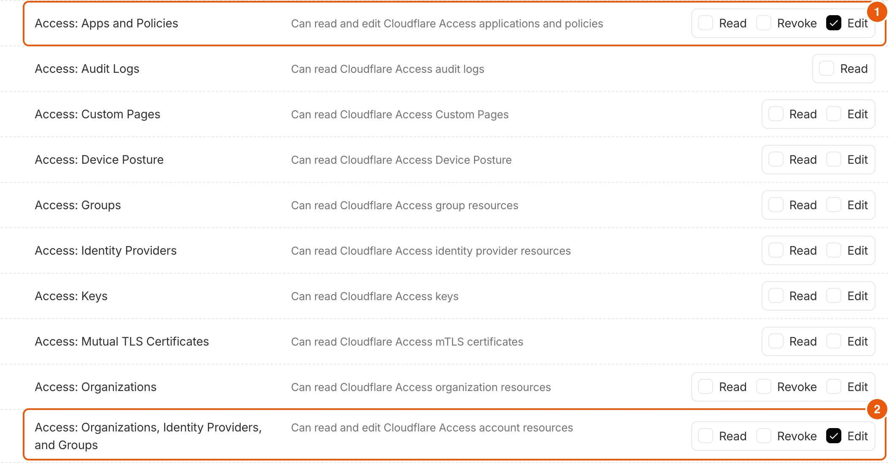
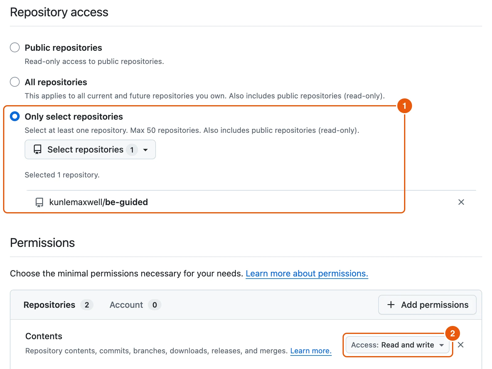

Be Guided runs on your own Cloudflare account. The setup takes about 10 minutes the first time, and you can stop at any step and run it again later.

## Before you start

You need:

- **Node.js 20 or newer** and **Git** on your computer.
- A free **Cloudflare** account.
- A free **GitHub** account. The online admin saves your guides to a GitHub repository.
- macOS, Linux, or Windows with WSL or Git Bash.

You don't need an AI API key. Ask AI on the guide site is optional.

## Steps

::::::steps
::::step{title="Fork and download the code"}
On GitHub, open **kunlemaxwell/be-guided** and select **Fork** to make your own copy. Then, in a terminal:

```bash
git clone https://github.com/<you>/be-guided.git
cd be-guided
npm install
```

`npm install` gets everything Be Guided needs, including Cloudflare's own tool, so you don't install anything else.
::::

::::step{title="Try it on your computer (optional)"}
Run the guide site and the admin in two terminals:

```bash
npm run dev -- -p 3100
```

```bash
npm run admin
```

Open **http://localhost:3100** for the guide site and **http://localhost:3101** for the admin. Changes you make in the admin are saved straight into the `content/` folder.
::::

::::step{title="Run the setup"}
```bash
npm run setup
```

The setup explains each step and waits for you. Your browser opens Cloudflare's sign-in page first. Sign in and select **Allow**.

It then creates the database and file storage, puts the admin online and puts the guide site online. Type **s** at any step to skip it and come back later.
::::

::::step{title="Lock the admin"}
When the setup reaches **Lock the admin so only you can open it**, type your email. Only this email can open the admin, and you become its first owner.

The setup then opens Cloudflare's **Create Token** page with the two boxes it needs already ticked. Select **Continue to summary**, then **Create Token**, then **Copy**, and paste the token into the setup. It stays hidden and isn't saved anywhere.



:::legend
1. **Access: Apps and Policies**, already set to **Edit**.
2. **Access: Organizations, Identity Providers, and Groups**, already set to **Edit**.
:::

:::note
The first time, Cloudflare may ask you to switch on **Zero Trust**, which runs the lock. The setup opens that page for you. Choose a team name and the **Free** plan (up to 50 people), then press Enter in the setup.
:::

The setup turns on sign-in by email code, locks the admin to your email, and leaves open the addresses your AI and the guide site use. You can delete the token afterwards.
::::

::::step{title="Connect GitHub"}
Enter your repository as **owner/name**, for example `your-name/be-guided`. Then paste a GitHub **fine-grained token** that can read and write **Contents** on that one repository only. It goes straight into Cloudflare and is never shown or saved on your computer.



:::legend
1. **Only select repositories**, with just your Be Guided repository picked.
2. **Contents** set to **Read and write**.
:::
::::

::::step{title="Note your three addresses"}
At the end the setup checks everything and prints:

- **Your guide site**, which your customers read.
- **Your admin**, where you and your team sign in.
- **AI connector URL**, which readers add to Claude or ChatGPT.
::::
::::::

## If something goes wrong

| What you see | What to do |
| --- | --- |
| The setup stops at a step | Run `npm run setup` again. Steps already done are skipped. Details are in `.wrangler/setup-logs/`. |
| Storage isn't switched on | In the Cloudflare dashboard, open **R2 Object Storage** and start using R2 (10 GB free), then run the setup again. Everything except uploads works without it. |
| "That token can't manage Access" | Make the token again from the page the setup opens, and keep both ticked permissions. |
| "AI connector answered 302" or a sign-in page | Run `npm run setup` again. It adds any open address that is missing. |
| The guide site isn't answering yet | Wait a minute and open it again. |

## What happens next

[Sign in to the admin](guide:getting-started/sign-in-to-the-admin), [add your first product](guide:writing-guides/add-a-product), and [connect your AI](guide:writing-with-ai/write-guides-with-your-ai) so it can write guides for you.

Prefer to let your AI do the typing? See [Set up Be Guided with your AI](guide:getting-started/set-up-with-your-ai).
