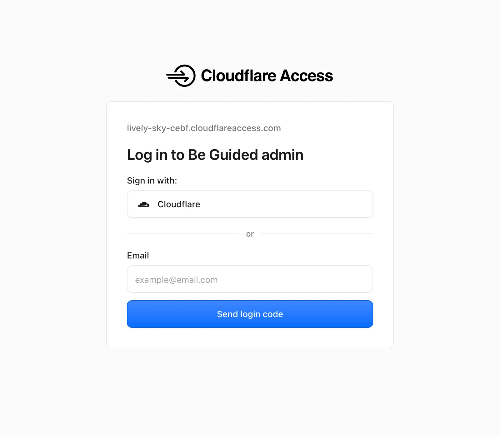
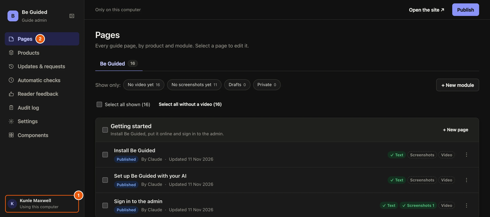

The admin is where you write guides, add products and choose who works on the guide. Online, Cloudflare asks who you are first. On your own computer there is no sign-in, because only you can reach it.

## Steps

::::::steps
::::step{title="Open your admin address"}
Open the admin address the setup gave you, for example `https://be-guided-admin.your-name.workers.dev`. Cloudflare shows its sign-in page.

::::

::::step{title="Get a code by email"}
Type your email and select **Send login code**. Copy the code from the email, paste it in and continue. The admin opens on **Pages**.

:::note
Only emails on the admin's list get a code. To let someone else in, [add them](guide:settings-and-people/add-people).
:::
::::

::::step{title="Or open it on your computer"}
In the project folder, run `npm run admin` and open **http://localhost:3101**. Under **Who is using this computer?** pick your name, then select **Use this person**, so your changes carry your name.

:::legend
1. Your name. Changes made here are saved under it.
2. **Pages** lists every guide page by product and module.
:::
::::
::::::

## Troubleshooting

| What you see | What to do |
| --- | --- |
| No code arrives | Check spam, then check your email is on the admin's list. |
| "The admin is not set up correctly yet." | Run `npm run setup` again. It finishes any step that is missing. |

## Related guides

- [Edit a page](guide:writing-guides/edit-a-page)
- [Add people](guide:settings-and-people/add-people)
