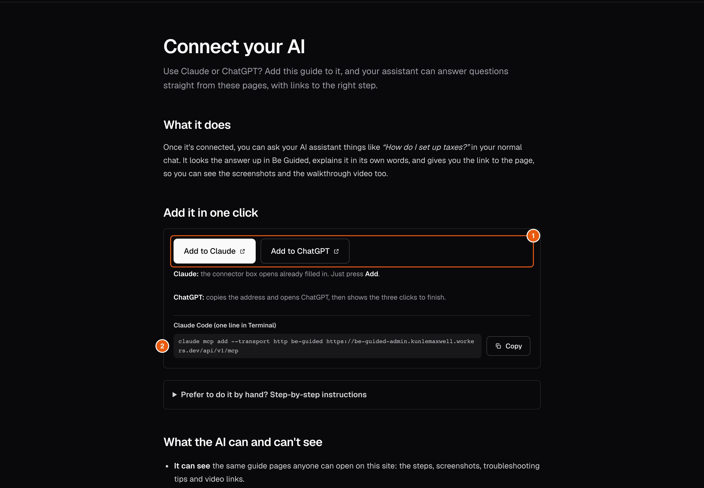

The guide comes with an AI connector. Once you add it, your assistant looks answers up in the guide, explains them and links to the right page. It is free, needs no key, and only reads public, published pages.

## Steps

::::::steps
::::step{title="Open Connect your AI"}
On the guide site, select **Use this guide in Claude or ChatGPT** at the bottom of any page.

:::legend
1. **Add to Claude** and **Add to ChatGPT** do most of the work for you.
2. The connector address, if you prefer to add it by hand.
:::
::::

::::step{title="Add it to Claude"}
Select **Add to Claude**. The connector box opens already filled in. Select **Add**.

By hand: in Claude, open **Customize**, then **Connectors**. Select **+ Add**, then **Add custom connector**, paste the connector address, choose **No sign in** and select **Add**.
::::

::::step{title="Or add it to ChatGPT"}
Select **Add to ChatGPT**. It copies the address, opens ChatGPT and shows the clicks to finish: **Plugins**, then **+**, then **Add custom MCP server**. Paste the address as the **Server URL** and choose **No authentication**.
::::

::::step{title="Ask a question"}
In a chat, switch the guide on (Claude: **+** then **Connectors**; ChatGPT: type **@** and pick it). Then ask, for example *"How do I install Be Guided?"*
::::
::::::

:::tip
In Claude Code, one line adds it: the page shows the exact `claude mcp add` command with a **Copy** button.
:::

## Related guides

- [Find a guide](guide:reading-the-guide/find-a-guide)
- [Write guides with your AI](guide:writing-with-ai/write-guides-with-your-ai), for people who update the guide.
