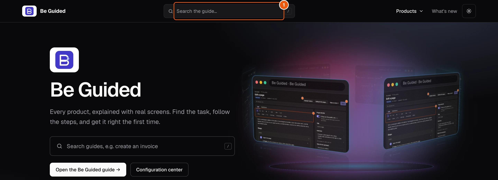
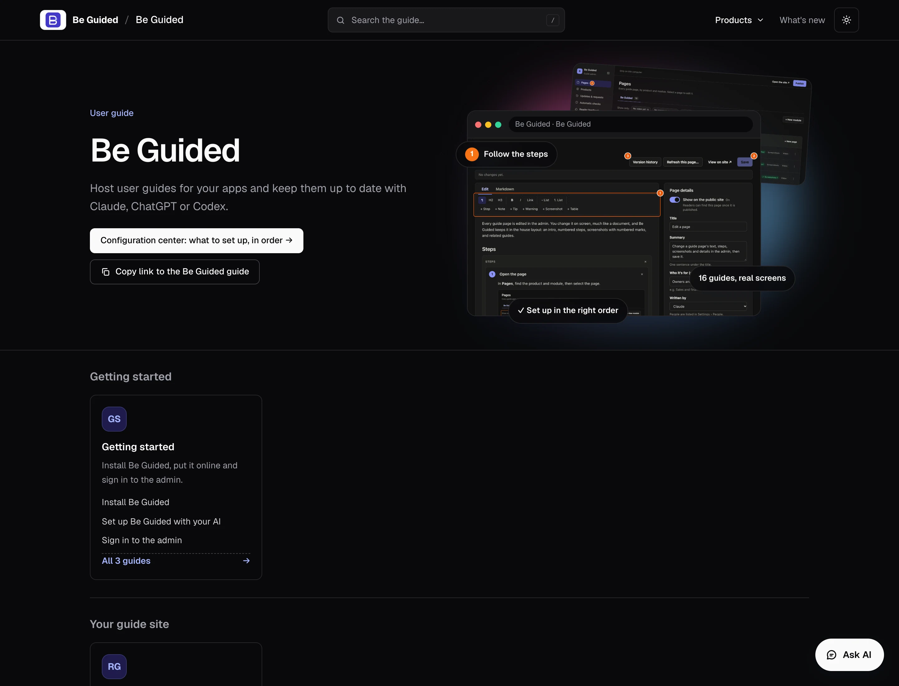

Your guide site has one section per product. Each product has modules, and each module has step-by-step pages with screenshots and, where there is one, a walkthrough video.

## Steps

::::::steps
::::step{title="Search from the home page"}
Type what you want to do in the search box, for example *install*. Press **/** on your keyboard to jump to the box from anywhere. Select a result to open the page.

:::legend
1. The search box.
:::
::::

::::step{title="Or open a product"}
Under **Pick your product**, select a product. Its page lists the modules, grouped by area, with the pages inside each one.

::::

::::step{title="Follow the steps"}
Each page starts with what the task does, then numbered steps. The numbers on a screenshot match the list under it.
::::
::::::

:::tip
Not sure where to start? The **Configuration center** on each product lists what to set up, in order.
:::

## Related guides

- [Share a product link](guide:reading-the-guide/share-a-product-link)
- [Use the guide in Claude or ChatGPT](guide:reading-the-guide/connect-your-ai)
