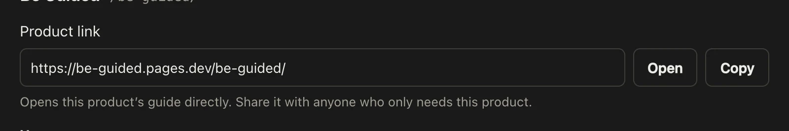

Every product has its own address. Share it with someone who only needs that product, and they skip the home page.

## Steps

::::::steps
::::step{title="Copy it from the guide site"}
Open the product, then select the copy-link button under its name, for example **Copy link to the Be Guided guide**. Paste the link wherever you need it.

:::legend
1. Copies the product's own address.
:::
::::

::::step{title="Or copy it from the admin"}
In the admin, open **Products** and select the product. Under **Product link**, select **Copy**, or **Open** to check it first.

::::
::::::

:::note
A product that is set to private or **Coming soon** has a link, but readers can't open its guides until it is public and **Available**.
:::

## Related guides

- [Add a product](guide:writing-guides/add-a-product)
