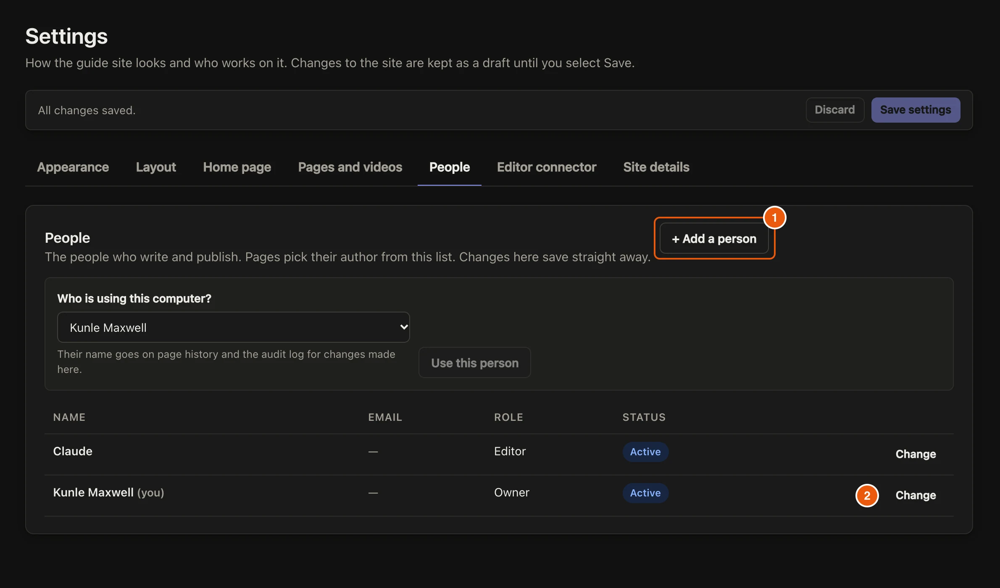

People in the admin have one of three roles. A **Viewer** can look but not change anything. An **Editor** can change pages, products, uploads and requests. An **Owner** can do everything, including people, settings and publishing.

## Steps

::::::steps
::::step{title="Open People"}
Open **Settings**, then **People**. Changes here save straight away.

:::legend
1. **+ Add a person**
2. **Change** a person's role, or switch them off.
:::
::::

::::step{title="Add the person"}
Select **+ Add a person**. Type their **Name** and **Email**, choose their role, then select **Add person**.

:::note
Online, the email is how they sign in. If you let the setup keep its Cloudflare token, they can sign in straight away. If not, also add their email to the admin's lock in Cloudflare: **Zero Trust**, then **Access**, **Applications**, **Be Guided admin**, **Policies**.
:::
::::

::::step{title="Switch someone off"}
Select **Change** next to them and switch them off. They stay in the history but can't be chosen as an author or sign in.
::::
::::::

## Related guides

- [Sign in to the admin](guide:getting-started/sign-in-to-the-admin)
- [Write guides with your AI](guide:writing-with-ai/write-guides-with-your-ai), which needs a person with the Editor or Owner role.
