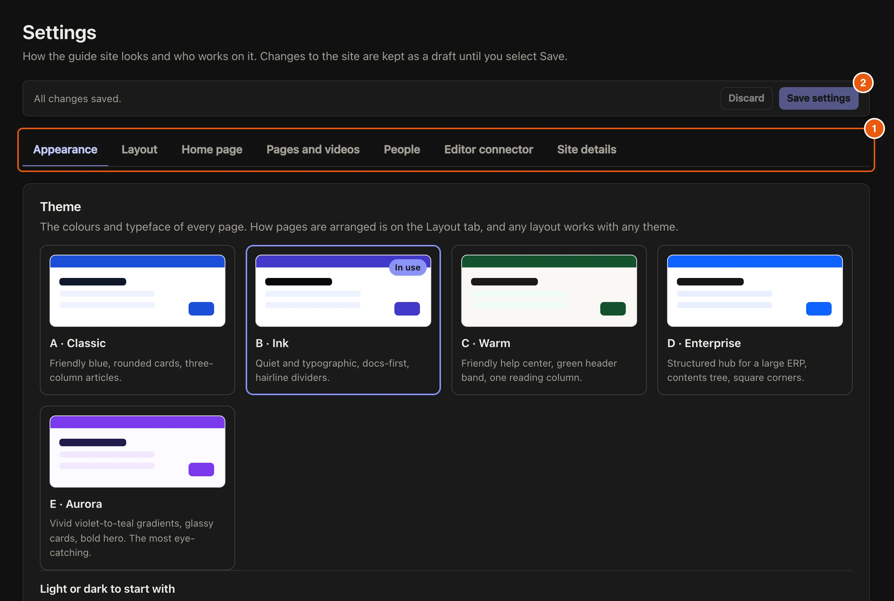

Your guide site can look like your brand. Changes in **Settings** are kept as a draft until you select **Save settings**, so you can try things out first.

## Steps

::::::steps
::::step{title="Pick a theme"}
Open **Settings**. On **Appearance**, pick a theme. Each one sets the colours and typeface of every page.

:::legend
1. The tabs: **Appearance**, **Layout**, **Home page**, **Pages and videos**, **People**, **Editor connector** and **Site details**.
2. **Save settings** keeps your changes. **Discard** throws them away.
:::
::::

::::step{title="Choose light or dark"}
Under **Light or dark to start with**, choose **Light**, **Dark** or **Match the reader's device**. Readers can still switch for themselves.
::::

::::step{title="Fine-tune it"}
Under **Customize the theme**, open **Colours**, **Text and fonts**, **Headings**, **Lines and corners** or **Shadows**. The **Preview** shows each change in light and dark as you go. **Reset everything to the theme** undoes them all.
::::

::::step{title="Set the layout and home page"}
On **Layout**, choose how pages are arranged. On **Home page**, choose what the top of the home page shows. Any layout works with any theme.
::::

::::step{title="Name the site"}
On **Site details**, set the **Site name** readers see in the header and browser tab, and an optional **Support link**. Then select **Save settings**.
::::
::::::

## Related guides

- [Publish the site](guide:writing-guides/publish-the-site)
