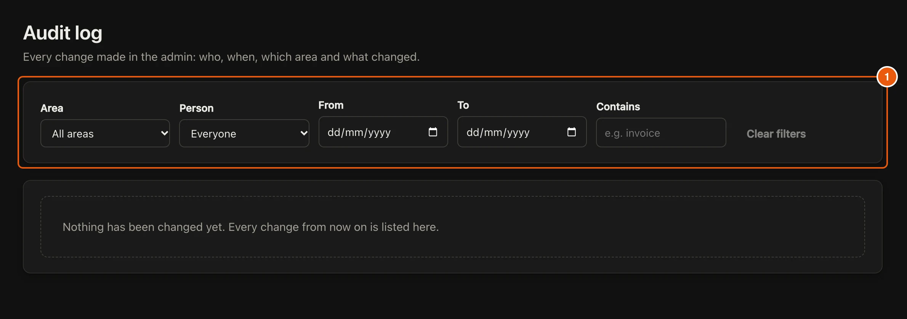

Be Guided records every change made in the admin, by people and by AI, and every **Was this helpful?** vote from readers.

## Steps

::::::steps
::::step{title="Open the Audit log"}
In the menu, select **Audit log**. It lists every change: who, when, which area and what changed.

:::legend
1. Filter by **Area**, **Person**, dates or text it **Contains**.
:::
::::

::::step{title="Read reader feedback"}
Select **Reader feedback**. It shows thumbs up and down for each page, readers' comments, and their email when they left one.
::::
::::::

:::tip
A page with several thumbs down is a good one to [improve with your AI](guide:writing-with-ai/write-guides-with-your-ai).
:::

## Related guides

- [Add people](guide:settings-and-people/add-people)
