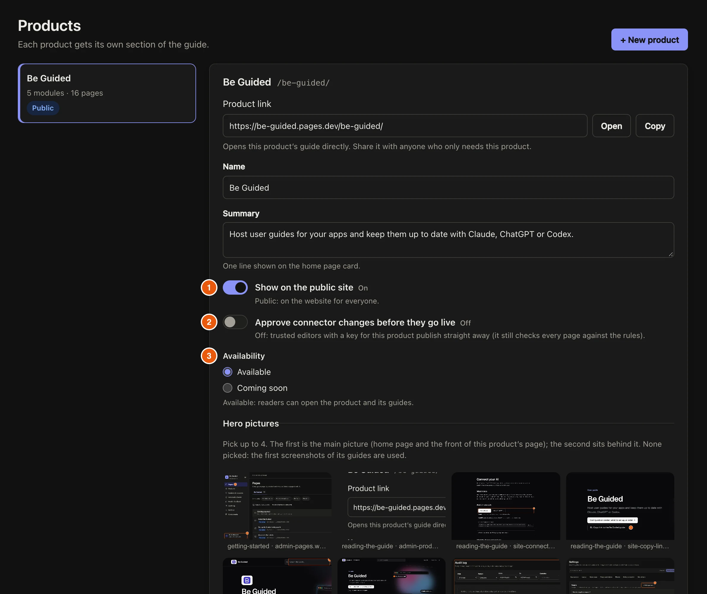

A **product** is one app you write guides for. It has its own page on the guide site and its own link. A **module** is one part of the product, such as Sales or Settings, and holds its pages.

## Steps

::::::steps
::::step{title="Add the product"}
Open **Products** and select **+ New product**. Give it a **Name** and a one-line **Summary**, which shows on the home page card.

:::legend
1. **Show on the public site**: off keeps the product private.
2. **Approve connector changes before they go live**: on means editors' AI changes wait for you.
3. **Availability**: **Coming soon** shows the card but not the guides.
:::
::::

::::step{title="Say where the app's code lives"}
Under **Where the app's code lives**, add the repository, branch and the folders with the screens. Your AI reads these to keep the guide in step with the app. Add **App addresses** too, so it can open the app for screenshots.
::::

::::step{title="Save the product"}
Select **Save product**.
::::

::::step{title="Add a module"}
Open **Pages** and select **+ New module** for the product. Give it a **Module name** and an **Area**. Modules in the same area are shown together on the product page.
::::
::::::

:::tip
Group modules by what the business does, not by who does it. Everything about one function, for staff, managers and admins, goes in one area.
:::

## Related guides

- [Share a product link](guide:reading-the-guide/share-a-product-link)
- [Edit a page](guide:writing-guides/edit-a-page)
