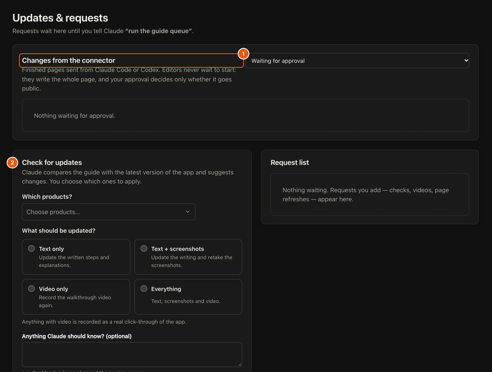

When a product has **Approve connector changes before they go live** switched on, pages that editors send from Claude Code or Codex wait for you in **Updates & requests**. Editors never wait to start. They write the whole page, and your approval decides only whether it goes public.

## Steps

::::::steps
::::step{title="Open Updates & requests"}
In the menu, select **Updates & requests**. Pages that are waiting are under **Changes from the connector**, **Waiting for approval**.

:::legend
1. Pages sent from an editor's AI.
2. **Check for updates** asks your AI to compare the guide with the latest app.
:::
::::

::::step{title="Review the page"}
Select **Review** on a waiting page. **Preview** shows how the page reads after approval, and **Compare text** shows what changed against the page that is **Live now**.
::::

::::step{title="Approve or reject"}
Select **Approve and publish**. The site updates in about 2 minutes. If you reject it instead, nothing changes on the site. Either way, the page moves to **Approved** or **Rejected**.
::::
::::::

## Related guides

- [Write guides with your AI](guide:writing-with-ai/write-guides-with-your-ai)
- [Schedule update checks](guide:writing-with-ai/schedule-update-checks)
