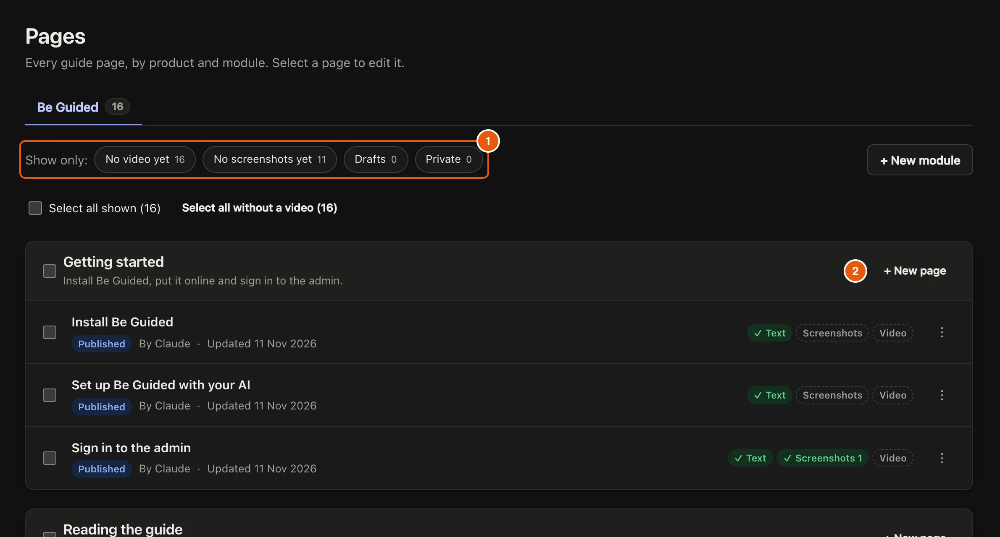
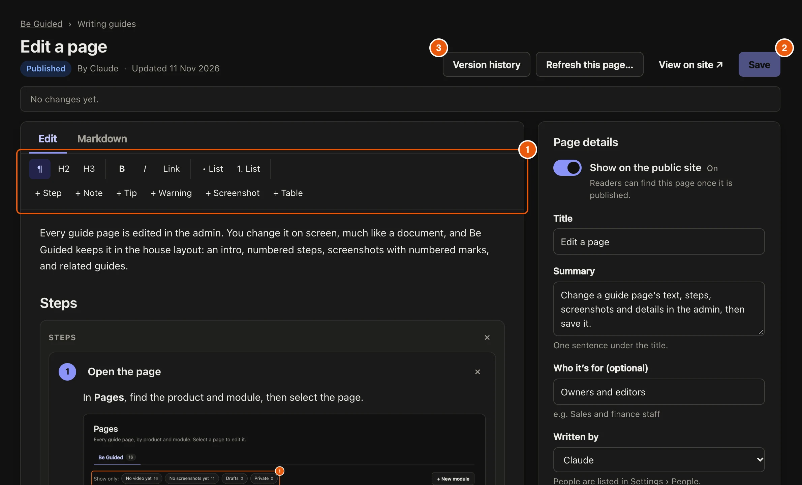

Every guide page is edited in the admin. You change it on screen, much like a document, and Be Guided keeps it in the house layout: an intro, numbered steps, screenshots with numbered marks, and related guides.

## Steps

::::::steps
::::step{title="Open the page"}
In **Pages**, find the product and module, then select the page.

:::legend
1. Filters such as **No video yet** and **Drafts** narrow the list.
2. **+ New page** adds a page to a module.
:::
::::

::::step{title="Change the text"}
Type straight into the page. Use the toolbar to add a **+ Step**, **+ Note**, **+ Tip**, **+ Warning**, **+ Screenshot** or **+ Table**. Select **Markdown** to see and edit the page as plain text.

:::legend
1. The toolbar.
2. **Save** keeps your changes.
3. **Version history** shows every saved version.
:::
::::

::::step{title="Check the page details"}
Open **Page details** to change the **Title**, **Summary**, **Status**, **Written by**, and the pages a reader should finish first under **Do these first**.
::::

::::step{title="Save"}
Select **Save**. Online, the change is saved to your GitHub repository and the guide site rebuilds within a few minutes. On your computer, it is saved into the `content/` folder.
::::
::::::

:::tip
To go back, open **Version history**, pick a version and compare **Before** and **After**. Only the text is kept in the history; screenshots and videos are not copied.
:::

## Related guides

- [Add a product or module](guide:writing-guides/add-a-product)
- [Write guides with your AI](guide:writing-with-ai/write-guides-with-your-ai)
