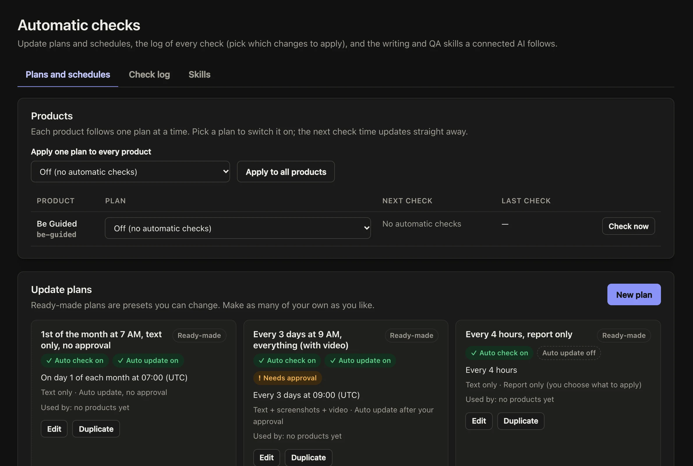

Apps change, and guides go out of date. Be Guided Studio runs on your computer and asks your AI to compare the guide with your app's latest code, on a schedule you choose.

## Steps

::::::steps
::::step{title="Install the Studio once"}
Download `be-guided-studio.zip` from your guide site's `/editor-kit/` folder and unzip it. In that folder, run:

```bash
bash install.sh
```

When it asks, paste your editor connector address (your admin address followed by `/api/v1/editor`), then your personal key. It adds the Studio to Claude Code and Codex.
::::

::::step{title="Choose a plan"}
In the admin, open **Automatic checks**. Pick how often each product is checked, for example every day at 8 AM, and the content mode. Choose whether changes are applied straight away or wait for you.


::::

::::step{title="Let it run"}
On a Mac, this runs waiting checks every 15 minutes:

```bash
node ~/.be-guided/studio/bin/be-guided-studio.mjs schedule --install
```

You can also ask your AI at any time: *"run the queued Be Guided checks"*.
::::

::::step{title="Pick what to apply"}
Each check is listed with what it found. Open one, tick the changes to apply and skip the rest.
::::
::::::

## Related guides

- [Approve changes](guide:writing-guides/approve-changes)
