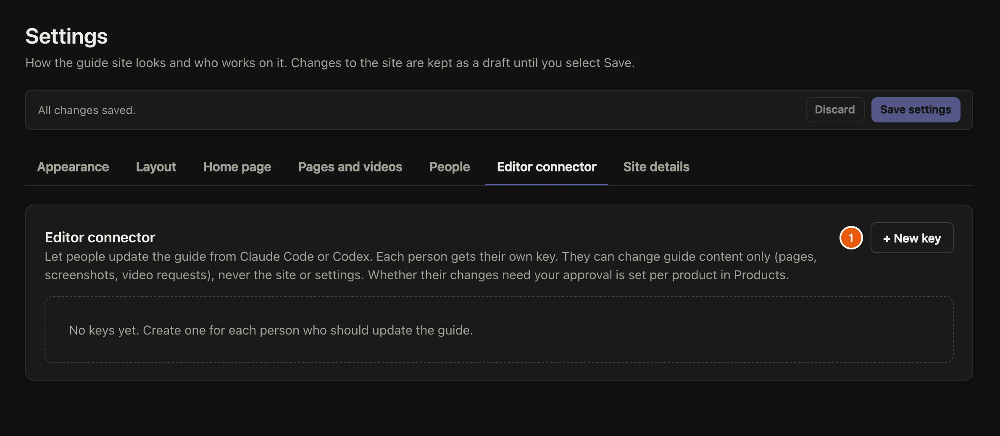

The editor connector lets Claude Code or Codex update the guide for you. It reads your app's code, writes pages in the house style, takes screenshots and saves them. It uses your own AI subscription, so there is no API key to buy. Each person has their own key, and it can change guide content only, never the site or its settings.

## Steps

::::::steps
::::step{title="Make a key"}
In the admin, open **Settings**, then **Editor connector**, and select **+ New key**. Choose the **Person**, give the key a name you will recognise, such as *Dana's laptop*, and pick which products it can update. Select **Create key**.

:::legend
1. **+ New key**. Only owners can see and create keys.
:::
::::

::::step{title="Add it to your AI"}
The admin shows the key once, with the exact line to copy:

- **Claude Code:** run the command it shows once in a terminal.
- **Codex:** add the block it shows to `~/.codex/config.toml`.

Run the **Screenshots** command too. It gives your AI the house screenshot look: sharp, with numbered outline boxes.

:::warning
Copy the key now. It isn't shown again. If it is lost, switch it off and make a new one.
:::
::::

::::step{title="Ask your AI"}
In Claude Code or Codex, ask, for example: *"Using Be Guided, write a guide for adding a customer in my app. The code is in ~/code/my-app."* Your AI asks which content mode you want (text only, text with screenshots, or everything with a video), then writes and saves the page.
::::

::::step{title="Check where it went"}
Owners' pages go live straight away. An editor's pages go live straight away too, unless the product asks for approval. Then they wait in [Updates & requests](guide:writing-guides/approve-changes).
::::
::::::

## Related guides

- [Schedule update checks](guide:writing-with-ai/schedule-update-checks)
- [Set up Be Guided with your AI](guide:getting-started/set-up-with-your-ai)
