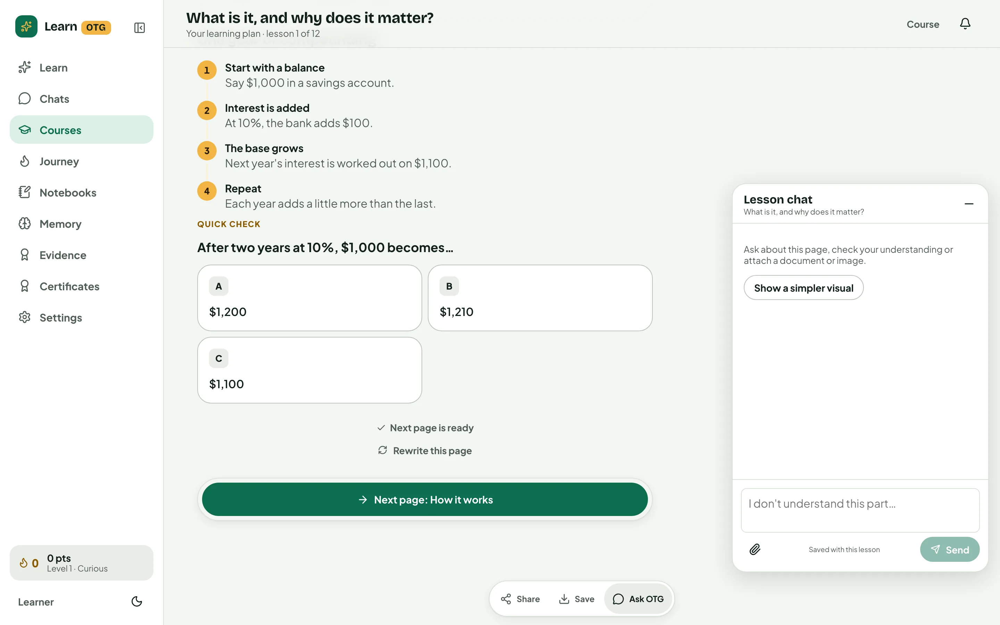

Every course lesson has its own tutor that knows the page you are on.

::::::steps
::::step{title="Open the tutor"}
Select **Ask OTG** at the bottom of the page. The **Lesson chat** opens beside the lesson.
::::

::::step{title="Ask your question"}
Type what you don't understand and select **Send**. Select the paperclip to attach a document or an image. Select a suggestion such as **Show a simpler visual** to get a new diagram.

::::
::::::

The chat is saved with the lesson, so you can come back to it later.
