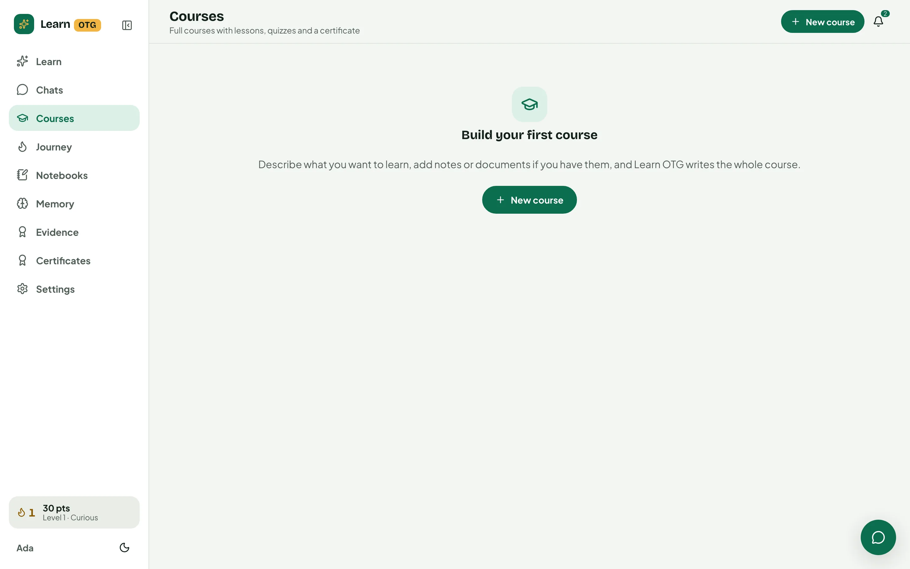
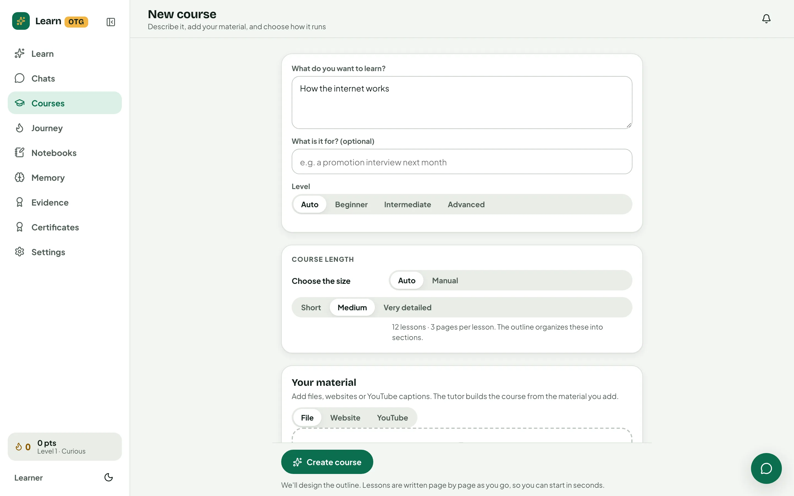
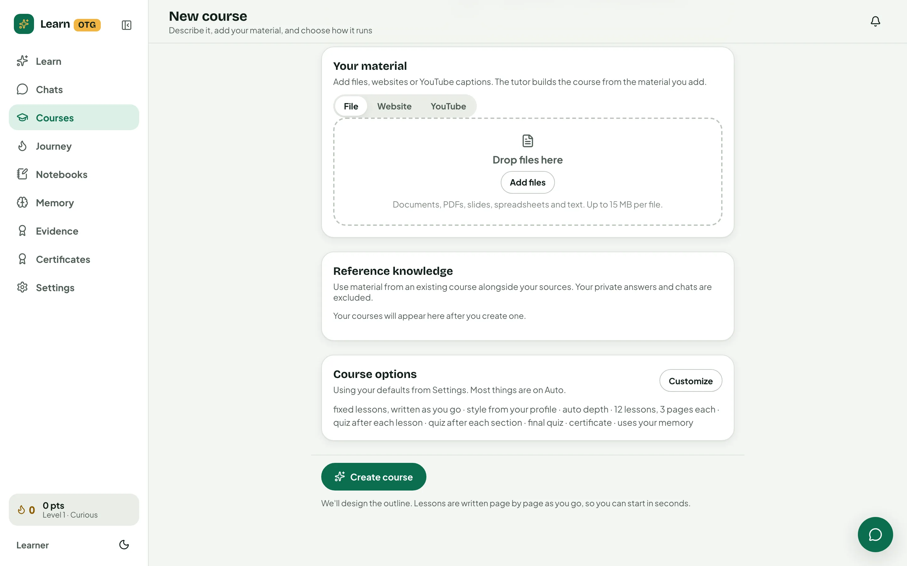

A course is a set of lessons with quizzes and a certificate. Lessons are written page by page as you reach them, so you can start in seconds.

::::::steps
::::step{title="Start a new course"}
Select **Courses**, then **New course**.

::::

::::step{title="Describe what you want to learn"}
Type the topic in **What do you want to learn?** Add **What is it for?** if you have a goal, such as an interview next month. Choose a **Level**, or leave it on **Auto**.
::::

::::step{title="Choose the size"}
Under **Course length**, choose **Short**, **Medium** or **Very detailed**. Select **Manual** to set your own number of lessons and pages.

::::

::::step{title="Add your own material (optional)"}
Under **Your material**, add files, a **Website** or **YouTube** captions. Files can be documents, PDFs, slides, spreadsheets and text, up to 15 MB each. Then choose **Only my sources and course references** or **My sources plus general knowledge**.

**Reference knowledge** lets you use material from a course you already made. **Course options** shows the defaults from Settings. Select **Customize** to change them.

::::

::::step{title="Create the course"}
Select **Create course**. Learn OTG designs the outline and opens the course.
::::
::::::
