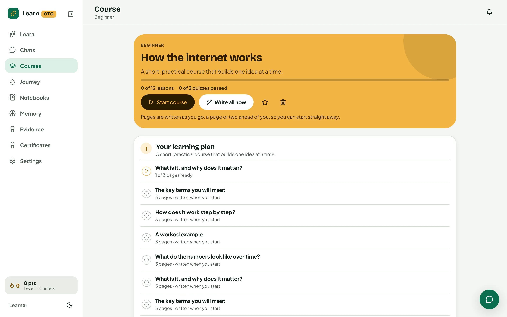
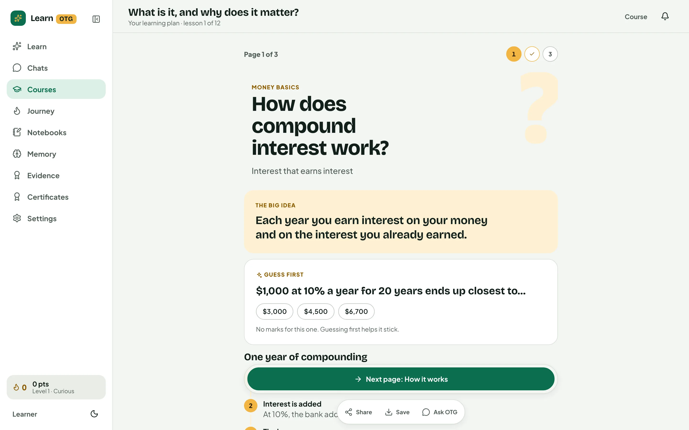
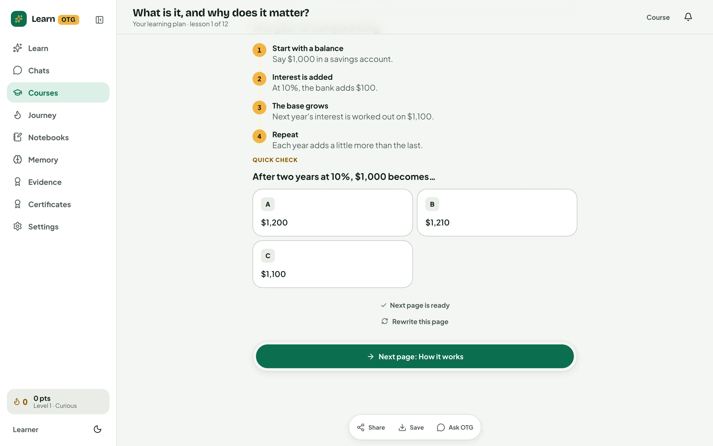
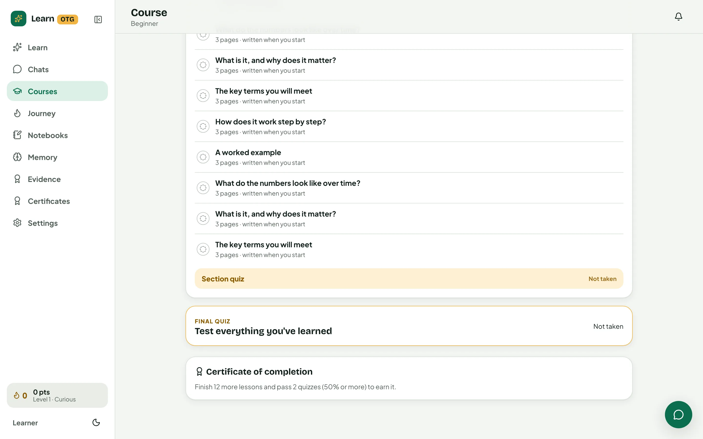

::::::steps
::::step{title="Open the course"}
The course page shows the title, your progress and **Your learning plan**. Select **Start course**. Select **Write all now** if you want every page written ahead.

::::

::::step{title="Read a lesson page by page"}
Each lesson has a few pages. The dots at the top show where you are. Answer **Guess first** and **Quick check** as you read.

::::

::::step{title="Go to the next page"}
At the end of a page, select **Next page**. The next page is written a page or two ahead of you. Select **Rewrite this page** if a page did not help.

::::

::::step{title="Pass the quizzes"}
Each section ends with a **Section quiz**, and the course ends with a **Final quiz**. The course page shows what you need for the **Certificate of completion**.

::::
::::::
