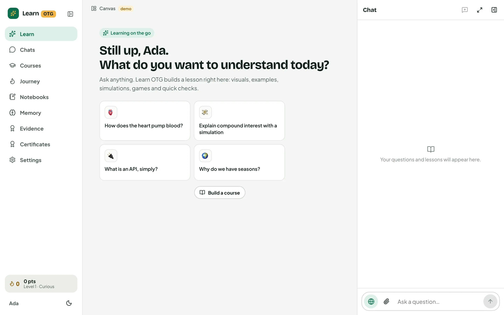

Learn OTG has three parts: the menu on the left, the canvas in the middle and the chat on the right.

:::legend
- **Learn**: ask a question and get a lesson on the canvas.
- **Chats**: reopen earlier questions and their lessons.
- **Courses**: build and follow full courses.
- **Journey**: your streak, points, level and badges.
- **Notebooks** and **Memory**: what you saved and what Learn OTG remembers about you.
- **Evidence** and **Certificates**: show what you learned.
- **Settings**: your profile, models and data.
:::

Your points and level show at the bottom of the menu. Select the panel button next to the logo to collapse the menu and give the lesson more room.

Learn OTG is built for phones too, so the same pages work on a small screen.
