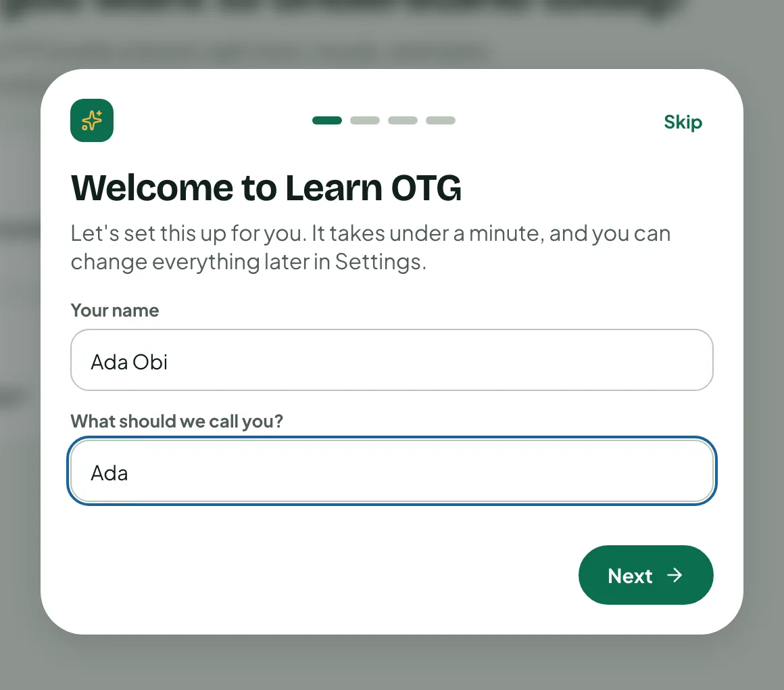
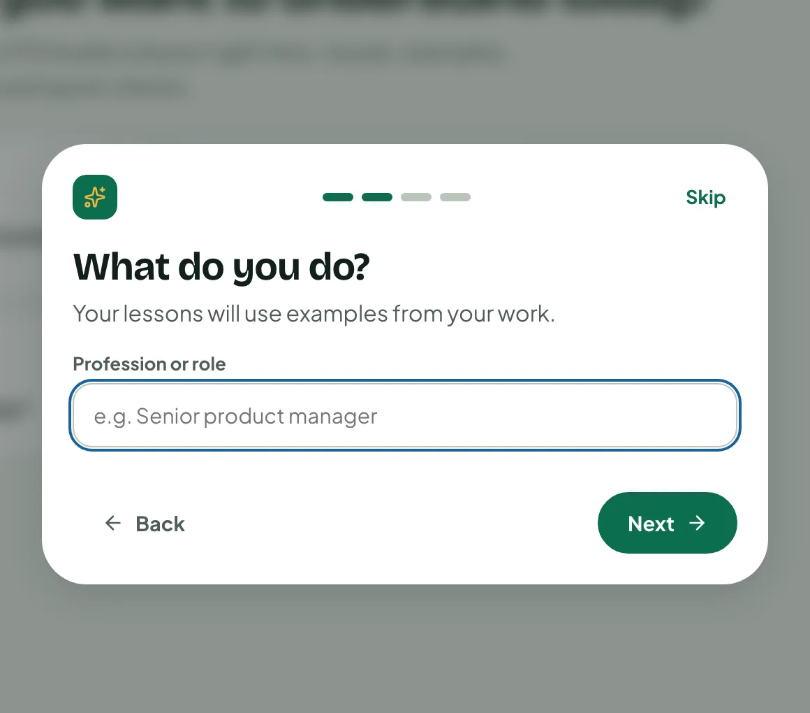
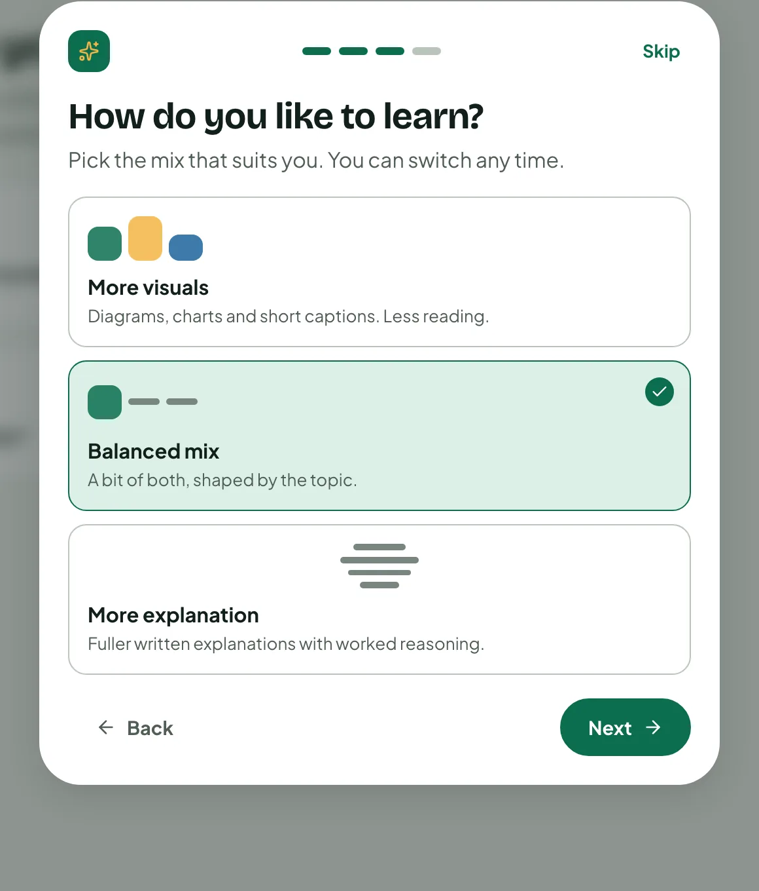
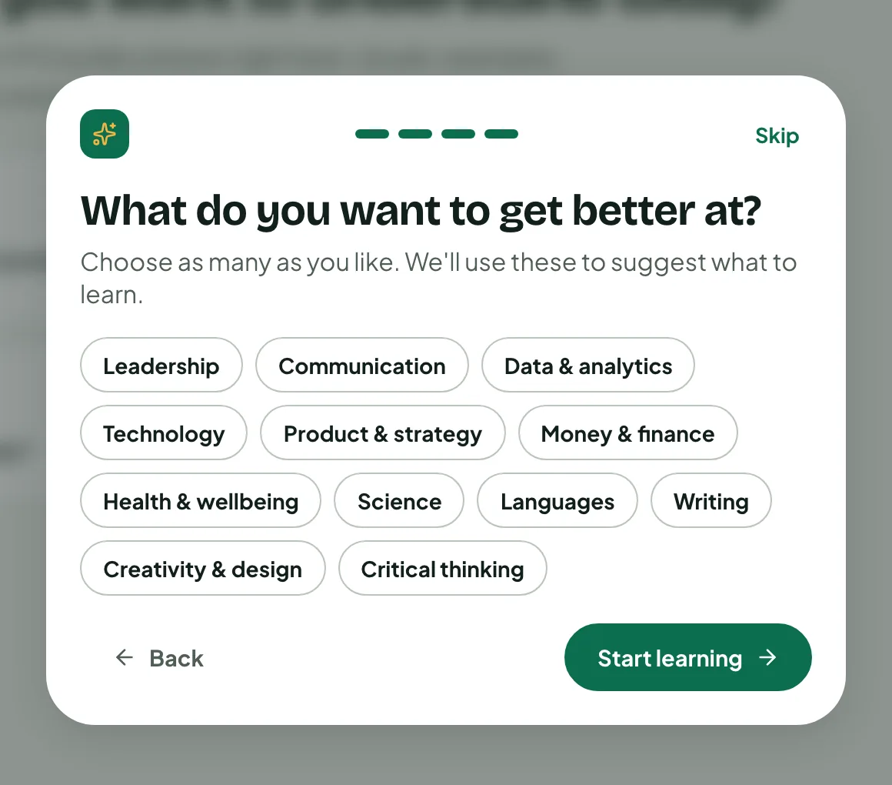

The welcome takes under a minute. Your answers shape every lesson, and you can change them later in **Settings**.

::::::steps
::::step{title="Add your name"}
Type **Your name** and what Learn OTG should call you, then select **Next**.

::::

::::step{title="Say what you do"}
Type your **Profession or role**. Lessons use examples from your work. Select **Next**.

::::

::::step{title="Choose how you like to learn"}
Pick **More visuals**, **Balanced mix** or **More explanation**. You can switch any time.

::::

::::step{title="Pick what you want to get better at"}
Choose as many areas as you like, such as **Leadership** or **Data & analytics**. Select **Start learning**.

::::
::::::

Select **Skip** on any step to go straight to the app.
