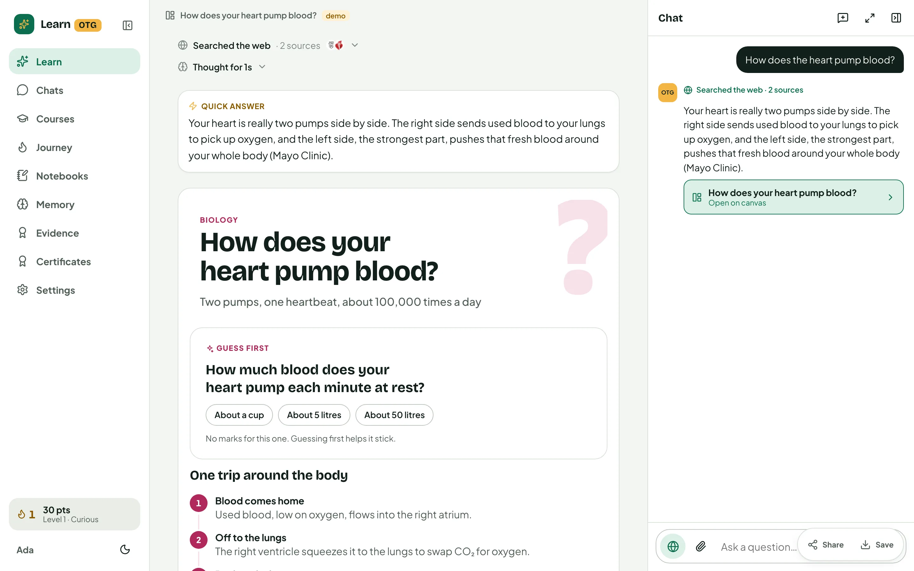
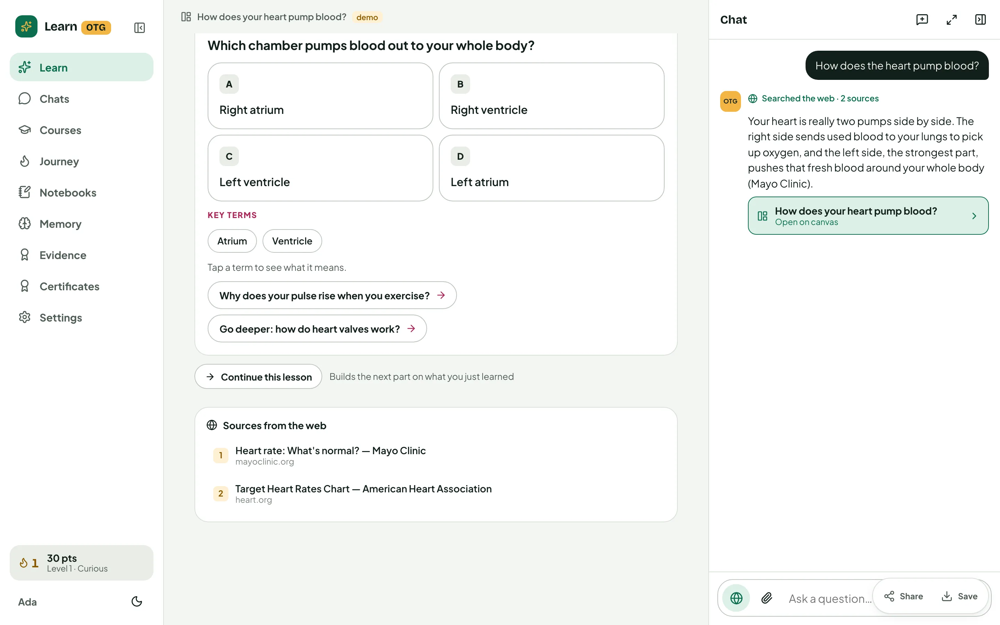

::::::steps
::::step{title="Ask a question"}
On **Learn**, type your question in **Ask a question** at the bottom, or select one of the suggestions. You can attach a document or a photo.
::::

::::step{title="Read the quick answer"}
A short **Quick answer** shows in a second or two while the full lesson builds. Rows such as **Searched the web** show what it did. Select a row to see the sources.
::::

::::step{title="Learn from the lesson"}
The lesson shows the big idea, steps, charts, comparisons and key terms.

::::

::::step{title="Go further"}
Below the lesson, select a key term to see what it means, pick a follow-up question, or select **Continue this lesson**. Sources from the web are listed at the end.

::::
::::::

:::note
Lessons come from free AI models and quick web searches. They can be wrong. Check anything important.
:::

Select any text in a lesson to ask about it or save it to a notebook. Use **Share** or **Save** at the bottom to keep the lesson.
