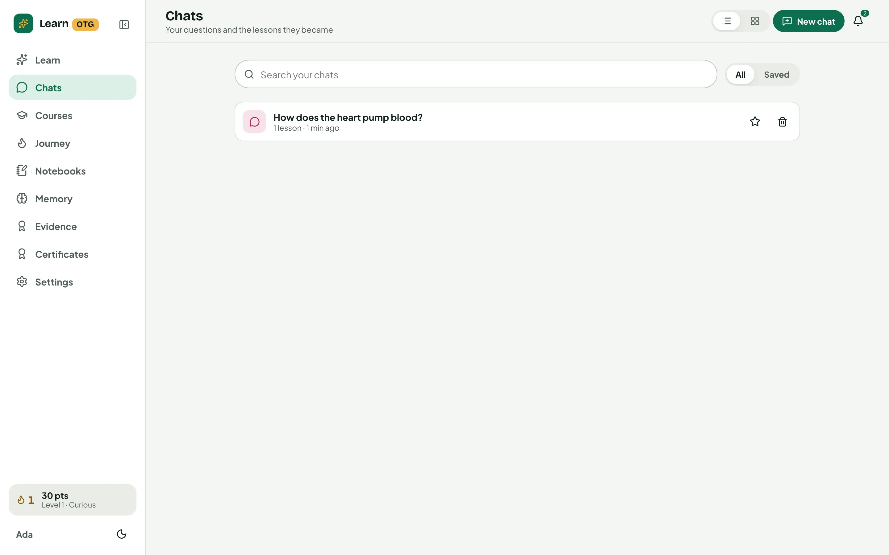

Every question is saved in this browser with its lessons.

::::::steps
::::step{title="Open Chats"}
Select **Chats** in the menu. Search your chats, or select **Saved** to see the ones you starred.

::::

::::step{title="Reopen or remove a chat"}
Select a chat to open it again. Select the star to save it, or the bin to delete it. Select **New chat** to start again.
::::
::::::

Chats stay on this device. There is no account, so clearing the browser's data also clears them.
