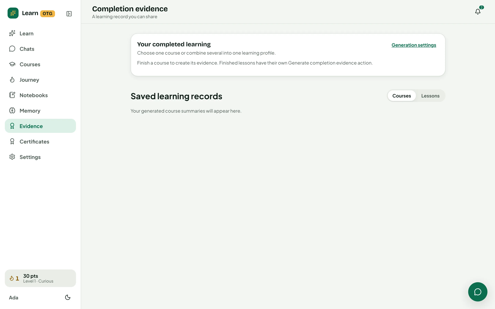
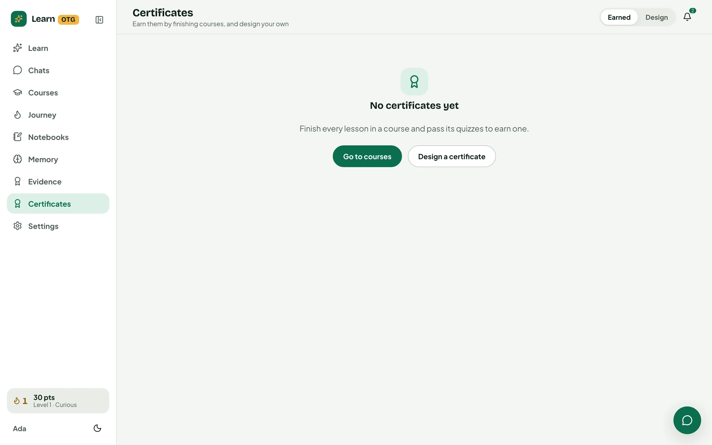

## Completion evidence

Select **Evidence** in the menu. Choose one course, or combine several into one learning profile. Evidence shows what you learned, the skills, worked scenarios and real counts from your progress. Share it as a link, an image or a PDF.

**Saved learning records** keeps the evidence you made, by **Courses** or **Lessons**.

## Certificates

Select **Certificates** in the menu. You earn a certificate when you finish every lesson in a course and pass its quizzes. Certificates come from your recorded progress, not from the AI. Select **Design a certificate** to change how they look.

:::note
Shared evidence links only work while the app is running at a public address.
:::
