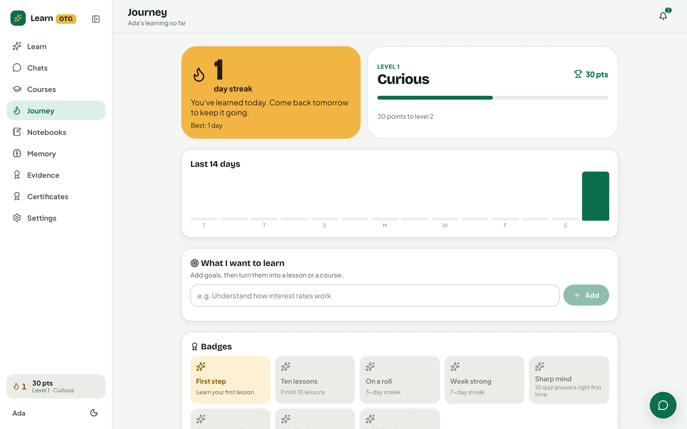

Select **Journey** in the menu.

:::legend
- **Day streak**: how many days in a row you learned. Learn something today to keep it going.
- **Level** and **points**: you earn points for lessons and quizzes. The bar shows how far you are from the next level.
- **Last 14 days**: how much you learned each day.
- **What I want to learn**: add a goal and select **Add**. Learn OTG suggests lessons and courses for it.
- **Badges**: earned for things like your first lesson, ten lessons or a week-long streak.
:::
