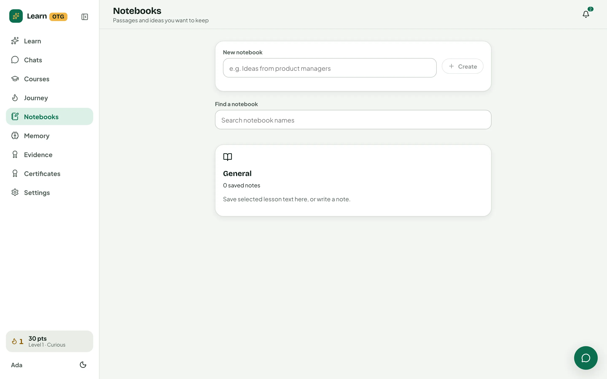
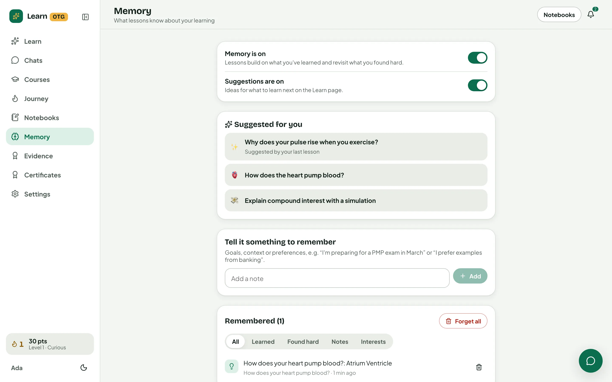

## Notebooks

Select any text in a lesson, then save it to a notebook. Select **Notebooks** in the menu to see them. Type a name under **New notebook** and select **Create** to start a new one. **General** holds notes you have not filed.

## Memory

Select **Memory** in the menu to see what lessons know about you.

- **Memory is on** lets lessons build on what you learned and revisit what you found hard.
- **Suggestions are on** shows ideas for what to learn next on the Learn page.
- **Tell it something to remember** adds a goal or preference, such as an exam date. Select **Add**.
- **Remembered** lists everything it keeps. Filter it, delete one item, or select **Forget all**.
