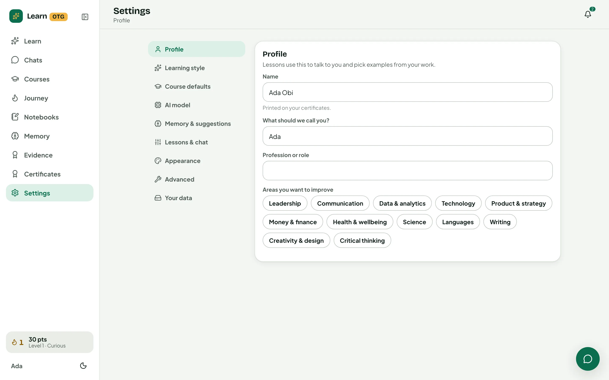

Select **Settings** in the menu. The sections are on the left.

:::legend
- **Profile**: your name, role and the areas you want to improve.
- **Learning style**: more visuals, a balanced mix or more explanation.
- **Course defaults**: the size, quizzes and certificate used for new courses.
- **AI model**: the model for lessons, its features, and web browsing.
- **Memory & suggestions**: the same switches as the Memory page.
- **Lessons & chat**, **Appearance** and **Advanced**: how lessons and the chat behave and look.
- **Your data**: see how much is saved in this browser, select **Download a backup**, or **Clear chat history**.
:::

## Choose a model

You can also select the model chip at the top right of a lesson.

- **GLM** on NVIDIA is the default and the most reliable.
- **Qwen** on Groq is about ten times faster. Pick it as your default if you only have a Groq key.
- **Kimi** on NVIDIA is good with photos and homework, but slower.

If an NVIDIA model returns 403, open that model's page on build.nvidia.com and select **Try API** once.
